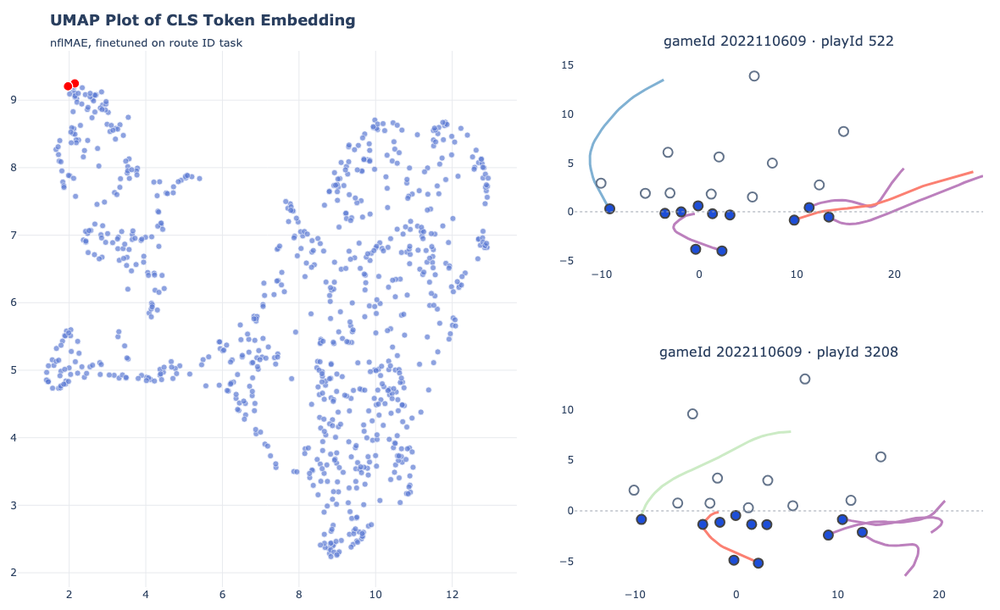
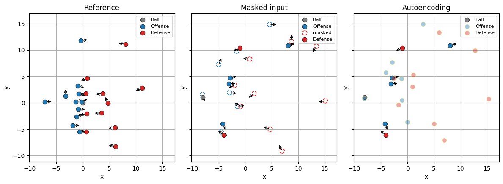

# nflMAE — Training a Self-Supervised Autoencoder for NFL Player Tracking


*<p style="text-align: center">Nearby plays highlighted in red are both screens to the right</p>*
___

&emsp;Transformers have been documented as a model architecture well-suited for solving problems with sports tracking data. Being permutation invariant with respect to input allows for models to overcome the "player ordering problem", and to be used for a variety of tasks when paired with task-specific heads. However, it is yet to be shown that the benefits of scale typically associated with transformer models apply to this type of tracking data. This project provides a general, self-supervised, pretraining recipe allowing for task specific models to take advantage of more data without requiring as many task-specific labels, and explores embedding space created by fine-tuning these generalized tracking models. 
___
## Pretraining

This repository sets up a masked auto encoding pretraining task, similar to the masked language modeling task from BERT. Individual frames are treated as a set of tokens, and a given training sample will mask a percentage of the players, and each masked player token's output is trained to reproduce the frame. The model is also given a reference frame, up to 30 frames prior, and is given a parameter to bias attention scores between the same player from the reference frame in order to differentiate between the masked tokens. 



*<p style="text-align: center">Reference, masked, and predicted autoencoding frames from a training sample</p>*

The model uses causal attention between different frames and uses RoPE to encode time differences between frames. \<CLS\> tokens are added to model inputs and used to probed gather play-wide information. Readers are encouraged to review the model archtecture and training task design at `models/backbones.py`, `models/models.py` and `models/train.py`. 

## Finetuning

3 NFL specific tasks were designed to evaulate the nflMAE model and training protocol.

| Task | Target | Entrypoint |
| --- | --- | --- |
| Route identification | Route runners and route labels | `nflMAE/scripts/run_route.py` |
| Tackle location | Ball-carrier position (x, y) at the tackle event | `nflMAE/scripts/run_tackle.py` |
| Coverage ID | Man / zone / other coverage label per play | `nflMAE/scripts/run_manzone.py` |

Each task relies on labeled data that may not always be available, but can easily be adapted to a generalized transformer model. On tasks requiring predicitons per-player, each player token is taken to make a prediciton. For predictions for the entire play, the \<CLS\> token is used, which showed better results when compared to pooling strategies over the sample of players. 


## Results

*d=32, n=4, h=2*

**Route ID**
| Model | Training Samples | Accuracy |
| --- | --- | --- |
| Transformer (from scratch) | 8 weeks (14,589 plays) | 0.6203 |
| nflMAE linear probing | 2 weeks (3,761 plays) | 0.4059 |
| nflMAE finetuned | 2 weeks | **0.6307** |

**Tackle Location**
| Model | Training Samples | ADE (yards)|
| --- | --- | --- |
| Transformer (from scratch) | 8 weeks (11,307 plays) | **4.5971** |
| nflMAE linear probing | 2 weeks (2,888 plays) | 6.6964 |
| nflMAE finetuned | 2 weeks | 4.6021 |

$\text{ADE} = \frac{1}{N}\sum_{i=1}^{N} \sqrt{(x_{\text{pred}}^{(i)} - x_{\text{true}}^{(i)})^2 + (y_{\text{pred}}^{(i)} - y_{\text{true}}^{(i)})^2}$

**Coverage ID**
| Model | Training Samples | Accuracy |
| --- | --- | --- |
| Transformer (from scratch) | 8 weeks (14,589 plays) | 0.8353 |
| nflMAE linear probing | 2 weeks (3,761 plays) | 0.7192 |
| nflMAE finetuned | 2 weeks | **0.8563** |

---
## Repository

```bash
git clone https://github.com/henrykra/nflMAE.git
cd nflMAE
pip install -e .
```

### Data

Training uses [NFL Big Data Bowl](https://www.kaggle.com/competitions/nfl-big-data-bowl-2025) tracking data, from the 2024 and 2025 competitions (more coming soon). Point the pipeline at your raw data checkouts via environment variables or use `.env`.

```
NFL_BDB_2024=/path/to/bdb2024
NFL_BDB_2025=/path/to/bdb2025
```

Processed datasets are cached and written to `datasets/` as parquet/torch files.

### Reproducing results

```bash
# 1. Pretrain the encoder (masked player reconstruction)
python nflMAE/scripts/run_pretrain.py

# 2. Fine-tune / linear-probe a downstream head on the pretrained checkpoint
python nflMAE/scripts/run_route.py
python nflMAE/scripts/run_tackle.py
python nflMAE/scripts/run_manzone.py
```

All runs are driven by YAML configs in `configs/` and log to TensorBoard, with
checkpoints and metrics saved under `experiments/`. Visualize with:

```bash
tensorboard --logdir experiments
```

### Repository layout

```
configs/     YAML configs for pretraining and each downstream task
nflMAE/
  data/      Big Data Bowl loaders and torch datasets
  models/    Transformer backbone and masked-autoencoder wrapper
  engines/   Pretraining and fine-tuning loops
  scripts/   Entry points for pretraining and downstream tasks
  utils/     Hooks, plotting, and small helpers
demo/        Notebook walkthrough of the model
```